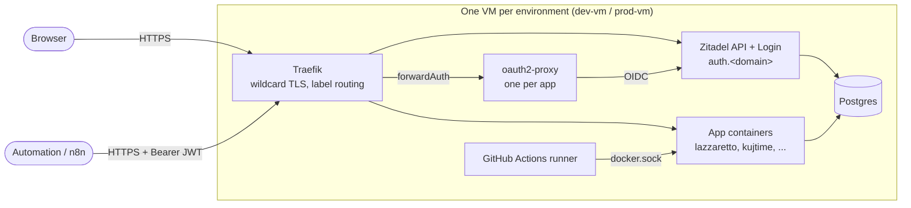
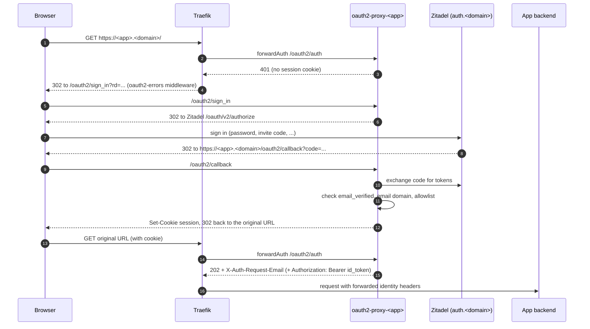
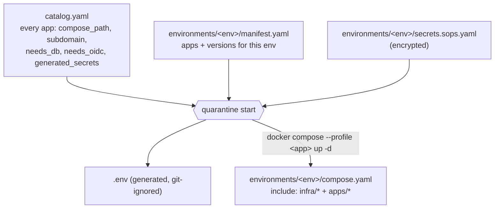

The platform turns one VM into a small, self-contained hosting environment:
an edge proxy with a wildcard certificate, an identity provider, a shared
database, and a set of apps declared in the repository. Everything is plain
Docker Compose, assembled and reconciled by the `quarantine` CLI.



## Hosts and domains

| Environment | Host | `DOMAIN` | Config on the host |
|---|---|---|---|
| dev | `dev-vm` | `dev.quarantine.al` | `/opt/quarantine/quarantine.yaml` with `env: dev` |
| prod | `prod-vm` | `quarantine.al` | `/opt/quarantine/quarantine.yaml` with `env: prod` |

On each VM:

| Path | What it is |
|---|---|
| `/opt/quarantine/repo` | Checkout of `QuarantineAl/platform` on `main`. The CLI and every compose file run from here. |
| `/usr/local/bin/quarantine` | Symlink to `/opt/quarantine/repo/bin/quarantine` |
| `/opt/quarantine/quarantine.yaml` | Host config: `repo`, `env`, `domain`, `email` (mode 0600) |
| `/opt/quarantine/keys/age-<env>.txt` | The environment's age private key. Never leaves the host, never committed. |
| `/opt/quarantine/tenants/<env>/<tenant>/` | Per-tenant Lazzaretto allowlists and `tenant.conf` (outside the repo on purpose: they hold real email addresses) |
| `environments/<env>/.env` | Generated by `quarantine start` from the decrypted secrets; git-ignored |

A third environment, `test` (only `uptime-kuma` in its manifest), exists in
the repository. No host for it was checked while writing this page.

## Edge: Traefik and the wildcard certificate

Traefik (`infra/edge/traefik/compose.yaml`) owns ports 80 and 443, redirects
HTTP to HTTPS, and discovers routes from Docker labels on the `edge` network
(`exposedByDefault=false`, so only containers with `traefik.enable=true` are
routed).

It requests **one wildcard certificate** for `<DOMAIN>` and `*.<DOMAIN>` from
Let's Encrypt with the Cloudflare **DNS-01** challenge, using the Cloudflare
token stored in the environment's secrets. Any new `<sub>.<DOMAIN>` hostname
(an app, a tenant, a PR sandbox) is therefore covered without a new
certificate or DNS change, provided the wildcard DNS record points at the host.

Every app container joins the external `edge` Docker network. Postgres sits on
a separate internal network (`quarantine-db`) that only Zitadel and the apps
that need a database join.

## Sign-in: the oauth2-proxy forward-auth pattern

Most first-party apps have no login code of their own. Instead each one gets a
dedicated oauth2-proxy instance (`infra/edge/oauth2-proxy/compose.yaml`) and
Traefik asks it, on every request, whether the caller is signed in:



What decides whether an authenticated person gets in:

| Setting on the oauth2-proxy instance | Effect |
|---|---|
| `OAUTH2_PROXY_EMAIL_DOMAINS: "*"` | Any Zitadel user of that environment is admitted. Used by delivery-note-ai, n8n, uptime-kuma and the shared Lazzaretto instance. |
| `OAUTH2_PROXY_EMAIL_DOMAINS: ""` + an authenticated-emails file | Only listed emails are admitted. Used by per-tenant Lazzaretto instances; managed with [`quarantine tenant`](/platform/cli/tenant/). |
| `email_verified` claim | oauth2-proxy rejects an ID token whose email is not verified, unless `--insecure-oidc-allow-unverified-email` is set. No instance here sets it. See [Verify a user's email](/platform/guides/users/verify-email/). |

Lazzaretto's instance also sets `OAUTH2_PROXY_SET_AUTHORIZATION_HEADER`, so the
backend receives `Authorization: Bearer <id_token>` and verifies it against
Zitadel's JWKS itself. See [Add OIDC to an app](/platform/guides/apps/add-oidc/)
for the full contract.

Not every app uses this pattern:

- **Kujtime** and **Vaultwarden** talk OIDC to Zitadel themselves (public
  pages must stay anonymous, or native clients cannot carry a proxy cookie).
- **Qualitech** and **Residences** are public static sites.
- **Portainer** uses its own local admin login.
- **SearXNG** has no route at all; only containers on the `edge` network reach it.

## Identity: Zitadel

One Zitadel instance per environment, served at `https://auth.<domain>`:

- `zitadel-api` (the API and OIDC endpoints) and `zitadel-login` (the Login V2
  UI under `/ui/v2/login`), both v4.16.1.
- One organisation, `quarantine`.
- One project, **`quarantine-apps`**, holding one OIDC application per catalog
  app with `needs_oidc: true`. Roles are defined once on this project and
  shared by every app in it, which is why role keys are app-prefixed
  (`lazzaretto-admin`, `kujtime:admin`).
- The project has **no** `projectRoleCheck` or `hasProjectCheck` (checked on
  both environments on 2026-10-23), so Zitadel itself lets any user of the
  organisation sign in to any app. Access control happens in oauth2-proxy and
  in the apps.
- Two machine users created at bootstrap: `quarantine-provisioner` (its PAT is
  what the CLI uses; it holds `IAM_OWNER` and `ORG_OWNER`) and `login-client`
  (used by the Login V2 UI).
- **No SMTP provider is configured** on either environment, so Zitadel cannot
  send email. Invites and verification codes are handed over by the operator.

The CLI never calls Zitadel through the public URL. It runs a throwaway
`curlimages/curl:8.11.1` container on the `edge` network and calls
`http://zitadel-api:8080` with a `Host: auth.<domain>` header (Zitadel picks the
instance from the Host header). See the [Zitadel API cookbook](/platform/api/zitadel/).

## Data: Postgres and Redis

- **Postgres 17** (`quarantine-postgres`) is shared. `provisioners/postgres.sh`
  creates one database and one role per consumer (Zitadel, then every catalog
  app with `needs_db: true`: today kujtime and n8n), generating each password
  on first run and storing it in the environment's secrets.
- **Redis (Valkey 9)** is defined in `infra/data/redis/` behind a `redis`
  profile with no consumer, so it never starts.
- Apps that keep their own state (Lazzaretto's SQLite, delivery-note-ai's
  uploads) use named Docker volumes.

:::caution
Nothing in the platform backs up volumes or Postgres. `quarantine destroy`
keeps volumes, but that is not a backup.
:::

## Observability

`infra/observability/` holds an OpenTelemetry collector and a SigNoz stack
(about 1.5 GB of RAM, seven containers). It starts only when the environment's
`manifest.yaml` sets `observability: true`; it is `false` on dev and absent on
prod. The flag is skip-only: setting it back to `false` never stops a stack
that is already running. `quarantine status` and `quarantine destroy` always
include it.

## CI runners

Each environment's `compose.yaml` includes `infra/ci/github-runner/`, an
ephemeral, org-scoped `myoung34/github-runner` that registers with the label
`quarantine-<env>`:

```yaml
runs-on: [self-hosted, quarantine-dev]   # or quarantine-prod
```

| Service | Runner group | Used by |
|---|---|---|
| `runner` | `first-party` | App deploys and PR sandboxes ([QuarantineAl/.github](https://github.com/QuarantineAl/.github) reusable workflows) |
| `runner-platform-deploy` | `platform-deploy` | This repository's own `deploy-platform.yml` (dev only today) |

The runner mounts `/var/run/docker.sock` and `/opt/quarantine`, so **it is
effectively root on its VM**. Only trusted, first-party code runs on it; fork
PRs stay on GitHub-hosted runners. The dev and prod pools are separate
containers on separate VMs with separate age keys.

See [Deploys](/platform/guides/apps/deploy/) and
[PR sandboxes](/platform/guides/pr-sandboxes/).

## Catalog and manifests



- `catalog.yaml` declares every app once. Each app's compose fragment puts its
  services behind a Compose **profile** named after the app.
- `environments/<env>/compose.yaml` includes the infra fragments and every app
  fragment that environment might run.
- `manifest.yaml` is the desired state: which profiles to activate, and which
  `<APP>_VERSION` image tag to export.
- `quarantine start` provisions databases and OIDC clients for manifest apps,
  starts them, and **stops** catalog apps that are no longer in the manifest.

Per-tenant Lazzaretto instances and PR sandboxes are separate Compose projects
(`quarantine-lazzaretto-<tenant>`, `pr-<n>-<app>`), outside this reconcile loop.

The generated [App catalog](/platform/reference/catalog/) lists every catalog
entry and which environment runs it.
