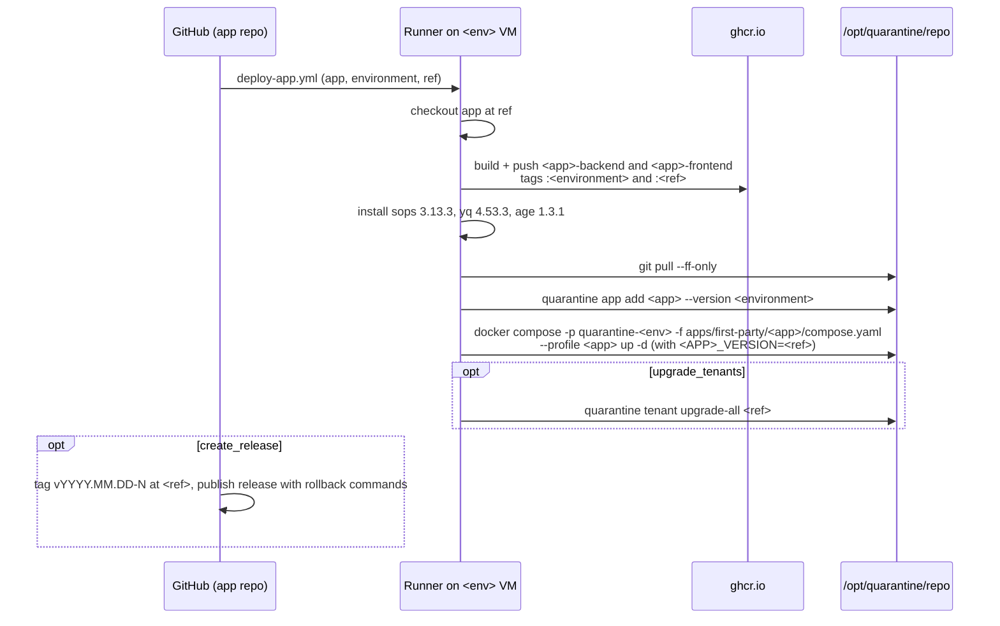

Two different things reach a VM, by two routes:

| What | Workflow | Trigger | Runs on |
|---|---|---|---|
| An app (new images) | App repo's caller → [`deploy-app.yml`](https://github.com/QuarantineAl/.github/blob/main/.github/workflows/deploy-app.yml) in QuarantineAl/.github, or the app's own workflow | Merge to the app's deploy branch | `[self-hosted, quarantine-<env>]` |
| The platform (this repo) | [`deploy-platform.yml`](https://github.com/QuarantineAl/platform/blob/main/.github/workflows/deploy-platform.yml) | Push to `main` (dev only); manual dispatch for dev or prod | `[self-hosted, quarantine-<env>]` on the `platform-deploy` runner |

The runner label picks the **host**. Both runners mount `/opt/quarantine`, so
the workflows act on the host's own checkout at `/opt/quarantine/repo`.

## App deploys: deploy-app.yml

A reusable workflow for two-image apps (`backend/` and `frontend/` directories).
Lazzaretto uses it. Qualitech, Residences and delivery-note-ai have different
shapes and deploy with workflows in their own repositories.

### Inputs

| Input | Required | Meaning |
|---|---|---|
| `app` | yes | Catalog name, also the repository name under QuarantineAl |
| `environment` | yes | `dev` or `prod`; selects the runner and the image tag |
| `ref` | yes | Commit SHA to deploy |
| `upgrade_tenants` | no (`false`) | Afterwards, run `quarantine tenant upgrade-all <ref>` |
| `create_release` | no (`false`) | Afterwards, tag and publish a GitHub Release on the app repo (caller must grant `contents: write`) |

```yaml title="lazzaretto/.github/workflows/deploy-main.yml"
name: Deploy main

on:
  push:
    branches: [main]

permissions:
  contents: write
  packages: write

jobs:
  deploy:
    uses: QuarantineAl/.github/.github/workflows/deploy-app.yml@main
    with:
      app: lazzaretto
      environment: prod
      ref: ${{ github.sha }}
      upgrade_tenants: true
      create_release: true
    secrets: inherit
```

Check the app's own `.github/workflows/` for its real callers (for Lazzaretto,
`develop` deploys to dev and `main` to prod).

### What it does



Points worth knowing:

- Images get two tags. The deploy runs the **SHA** tag, so a concurrent merge
  cannot swap the build under it. The manifest records the moving
  `:<environment>` tag, so the host checkout stays clean.
- It deliberately does **not** run `quarantine start`. That would reconcile the
  whole environment and could recreate the runner executing the job. It only
  brings up the app's own services, using `environments/<env>/.env` for OIDC
  and secret variables.
- Because of that, a later `quarantine start` moves the shared instance to
  whatever `:<environment>` points at (the newest build).
- The backend and frontend images get `BUILD_SHA=<ref>` as a build argument, so
  the running app can report its commit.
- Tenants are upgraded one by one, each waiting for health, stopping at the
  first failure. Recreating a tenant backend kills agent turns in flight.

### Releases and rollback

With `create_release`, the release is tagged CalVer (`v2026.08.12-1`) and its
body lists the image references and the rollback commands for that build. It is
the record of what prod is serving.

To roll back, on the target VM, with the SHA from the release:

```bash title="prod VM"
cd /opt/quarantine/repo
./bin/quarantine app add lazzaretto --version <sha>
./bin/quarantine start
./bin/quarantine tenant upgrade-all <sha>      # only for apps with tenants
```

:::caution
`app add` edits the tracked `manifest.yaml`. Commit the change, or the next
deploy's `git pull --ff-only` fails on the dirty file. The next normal deploy
sets the version back to `:<environment>`.
:::

## Platform deploys: deploy-platform.yml

Ships changes to this repository. It builds nothing: it updates the host
checkout and reconciles.

1. Installs sops, yq and age in the runner.
2. **Refuses to run** if `git status` shows changes under `environments/`.
   These are almost always secrets the host generated and nobody committed.
3. Runs `./bin/quarantine upgrade` (`git fetch` + fast-forward of `main`, then
   `quarantine start`) with `QUARANTINE_SKIP_RUNNER=true`, so it does not
   recreate the runner it is running on.
4. Warns if the merge touched `infra/ci/github-runner/`: those changes are
   pulled but not applied; run `quarantine start` on the VM over SSH.

A push to `main` deploys **dev only**. Prod is a manual run:

```bash title="Laptop, with gh"
gh workflow run deploy-platform.yml -R QuarantineAl/platform -f environment=prod
```

Runs are serialised per host (`concurrency: deploy-platform-<env>`).

:::caution[Dirty checkout]
If the deploy fails with "Host checkout has uncommitted changes under
environments/", do **not** discard them. Copy the file off the host, open a PR
with it, merge, then restore the host copy from `origin/main`. See
[Committing generated secrets](/platform/guides/secrets/#committing-generated-secrets).
:::

## Deploying by hand

On the VM, the equivalent of a platform deploy is:

```bash
cd /opt/quarantine/repo
git status --short           # must be clean
quarantine upgrade
```

For an app, either re-run its workflow from GitHub, or replicate the scoped
deploy step:

```bash title="dev VM"
cd /opt/quarantine/repo
export DOMAIN=dev.quarantine.al LAZZARETTO_VERSION=<sha>
docker compose --project-name quarantine-dev --env-file environments/dev/.env \
  -f apps/first-party/lazzaretto/compose.yaml --profile lazzaretto up -d
```

## Checking what is deployed

```bash title="On the VM"
docker ps --format '{{.Names}}\t{{.Image}}' | grep lazzaretto
quarantine tenant list          # VERSION column = running image tag
```
