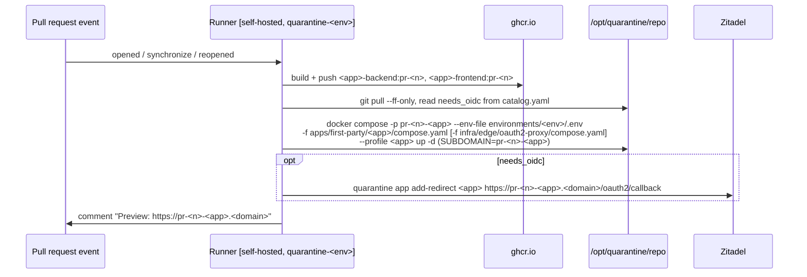

An app can get a live preview of every pull request at
`https://pr-<n>-<app>.<domain>`. The sandbox runs on the same VM as the
environment it targets, next to the persistent deployment, sharing its Traefik,
wildcard certificate, Zitadel and (for OIDC apps) the app's Zitadel
application. Lazzaretto uses this today; on 2026-10-23 dev was running
`pr-153`, `pr-154` and `pr-155-lazzaretto`, plus `pr-6-qualitech` (Qualitech
uses its own workflow).

## Which environment

The caller decides from the PR's **base branch**:

| Base branch | Sandbox on | Hostname |
|---|---|---|
| `develop` | dev VM | `pr-<n>-<app>.dev.quarantine.al` |
| `main` | prod VM | `pr-<n>-<app>.quarantine.al` |
| anything else | no sandbox | |

No DNS or certificate work is needed per PR: the environment's wildcard
certificate already covers the hostname.

## Wiring it into an app

```yaml title="lazzaretto/.github/workflows/pr-preview.yml"
name: PR preview

on:
  pull_request:
    types: [opened, synchronize, reopened, closed]

permissions:
  contents: read
  packages: write
  pull-requests: write

jobs:
  up:
    if: github.event.action != 'closed' && (github.event.pull_request.base.ref == 'develop' || github.event.pull_request.base.ref == 'main')
    uses: QuarantineAl/.github/.github/workflows/pr-sandbox-up.yml@main
    with:
      app: lazzaretto
      environment: ${{ github.event.pull_request.base.ref == 'develop' && 'dev' || 'prod' }}
      pr_number: ${{ github.event.pull_request.number }}
      ref: ${{ github.event.pull_request.head.sha }}
    secrets: inherit

  down:
    if: github.event.action == 'closed' && (github.event.pull_request.base.ref == 'develop' || github.event.pull_request.base.ref == 'main')
    uses: QuarantineAl/.github/.github/workflows/pr-sandbox-down.yml@main
    with:
      app: lazzaretto
      environment: ${{ github.event.pull_request.base.ref == 'develop' && 'dev' || 'prod' }}
      pr_number: ${{ github.event.pull_request.number }}
    secrets: inherit
```

Requirements on the app:

- Two-image shape: `backend/` and `frontend/` Dockerfiles (the workflow builds
  both).
- Its compose fragment templates every hostname, container name and Traefik
  router name from `${SUBDOMAIN}` (see `apps/first-party/lazzaretto/compose.yaml`).
- If `needs_oidc: true`, its oauth2-proxy block is `${SUBDOMAIN}`-templated too
  ([Add OIDC to an app](/platform/guides/apps/add-oidc/)).
- Sandboxes only run trusted code: the runner is root-equivalent on the VM.

## What pr-sandbox-up.yml does

Inputs: `app`, `environment`, `pr_number`, `ref` (all required).



- The Compose project `pr-<n>-<app>` is the isolation unit: its own containers,
  network and volumes.
- It is not in any manifest, so `quarantine start` and `quarantine status`
  ignore it.
- Every push rebuilds `:pr-<n>` and re-runs `up -d`. Re-adding the same redirect
  URI is a no-op.
- The sandbox shares the app's Zitadel application (same client id/secret) and
  session cookie, so someone signed in to the persistent instance is signed in
  to its sandboxes. On dev, the Lazzaretto sandbox admits any dev Zitadel user.

## What pr-sandbox-down.yml does

Inputs: `app`, `environment`, `pr_number`. On `closed` (merged or not):

1. `docker compose -p pr-<n>-<app> ... down -v`: containers **and volumes** are
   deleted.
2. If `needs_oidc`, `quarantine app remove-redirect <app> <callback>`. A failure
   here fails the job, so a stale URI is noticed.

## Inspecting and cleaning up by hand

```bash title="dev VM: list sandboxes"
docker compose ls --all | grep '^pr-'
quarantine app list-redirects lazzaretto
```

```bash title="dev VM: logs of one sandbox"
docker logs -f quarantine-pr-153-lazzaretto-backend
```

If a PR closed but its sandbox stayed (for example the runner was offline), tear
it down the way the workflow does:

:::danger
`down -v` deletes the sandbox's volumes.
:::

```bash title="dev VM, for PR 153 of lazzaretto"
cd /opt/quarantine/repo
docker compose --project-name pr-153-lazzaretto \
  -f apps/first-party/lazzaretto/compose.yaml -f infra/edge/oauth2-proxy/compose.yaml \
  --profile lazzaretto down -v
quarantine app remove-redirect lazzaretto https://pr-153-lazzaretto.dev.quarantine.al/oauth2/callback
```

## Known gaps

- No database clean-up: a `needs_db` sandbox would leave its database behind.
  Today's sandboxed apps do not use Postgres.
- Sandboxes on dev take the compose defaults for Lazzaretto (concurrency 4,
  2700 MiB memory limit each), which adds up on a small VM.
- `docs/runners-and-sandboxing.md` describes a per-PR Zitadel application and
  database; the workflows actually share the app's application and create no
  database.
